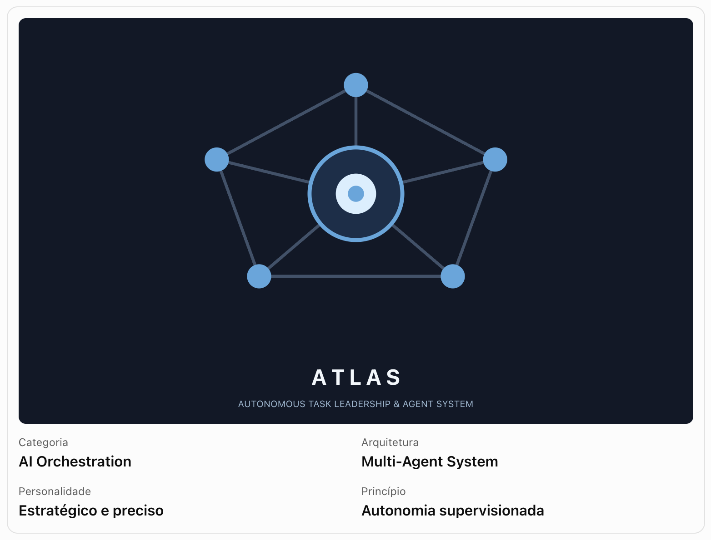

# ATLAS

<p align="center">
  
</p>

**Autonomous Task Leadership & Agent System** — a local-first development environment
for managing multiple projects and their terminals (and, in future specifications, AI
agent teams).

Implemented: **SDD-001 — Project Registry**, **SDD-002 — Terminal Manager** and
**SDD-003 — Workspace, Git and ATLAS Sessions** (see `docs/sdd/`).

## Requirements

- macOS (verified), Linux/Windows (not yet verified)
- Node.js 24 LTS (`>= 24`)
- pnpm 11 (`corepack enable` or a global install)

Linux needs a C/C++ toolchain and Python for `node-pty`, which compiles during installation
(macOS and Windows use prebuilt binaries).

## Getting started

```bash
pnpm install          # also downloads the Electron binary
pnpm build            # builds packages, Engine, CLI and the desktop bundles
pnpm --filter @atlas/desktop start   # run the built desktop app
pnpm dev              # run the desktop app with hot reload
```

### CLI

```bash
pnpm atlas project list
pnpm atlas project add <path> [--name <name>] [--description <text>] [--tag <tag>...]
pnpm atlas project show <id>
pnpm atlas project remove <id> [--yes]
# add --json to list/add/show for machine-readable output
```

The project commands work without the desktop app and share its database.

```bash
pnpm atlas terminal list [--project <id>] [--json]
pnpm atlas terminal open [--project <id> | --cwd <path>] [--shell <shell-id>] [--title <name>] [--json]
pnpm atlas terminal rename <terminal-id> (<name> | --auto)
pnpm atlas terminal show <terminal-id> [--json]
pnpm atlas terminal close <terminal-id> [--yes]
```

```bash
pnpm atlas session create --name <name> --objective <text> [--project <id> | --cwd <path>] [--profile economy|balanced|maximum] [--constraint <text>...]
pnpm atlas session list [--project <id>] [--all]
pnpm atlas session show <session-id>
pnpm atlas session tasks <session-id>
pnpm atlas session ready|start|pause|resume|archive <session-id>
pnpm atlas session cancel <session-id> [--yes]
# add --json for machine-readable output
```

Session commands use the running app's Engine when it is open (so it updates live) and the
database directly otherwise.

Terminal commands talk to the Engine of the running ATLAS Control app through an
authenticated local socket; they fail with "The ATLAS Engine is not running" otherwise.
Terminals opened from the CLI appear as tabs in the app.

### Terminals

Open **Terminals** in the sidebar (or "Open terminal" on a project). Terminals can belong
to a project or be standalone (default directory, configurable in Settings, or any folder
chosen in the picker). Organize them in groups — each group has its own tabs and split
panes, and switching groups never stops processes. Terminal headers show the branch,
modified/staged counts and ahead/behind of the repository the shell is in; project details
show the full Git summary (read-only; ATLAS never fetches or changes repositories). Keyboard shortcuts
are listed in the application menu and in `docs/sdd/SDD-002-terminal-manager.md`.
Quitting ATLAS terminates all terminal processes (it asks first while any are running).
Extra shells, such as a WSL launcher, can be added in `<data dir>/shells.json`.

### Sessions

Open **Sessions** in the sidebar (or "New session" on a project). A session records an
objective, a workspace (project, folder or none), an execution profile, constraints and a
plan of tasks with dependencies; its lifecycle and every change are kept in an event
history. No AI provider is involved yet: a started session waits for an executor, and the
app always shows that nothing is executing.

### Headless Engine

```bash
pnpm engine status    # boots the Engine without Electron and prints a health report
```

### Data location

| OS      | Directory                                       |
| ------- | ----------------------------------------------- |
| macOS   | `~/Library/Application Support/ATLAS`           |
| Windows | `%APPDATA%\ATLAS`                               |
| Linux   | `$XDG_DATA_HOME/atlas` (`~/.local/share/atlas`) |

Set `ATLAS_DATA_DIR` to use another directory (for example, a throwaway one for testing).
Logs are written to `<data dir>/logs/atlas.log`; the CLI socket and its token file live in
`<data dir>/run/` (user-only permissions).

## Quality checks

```bash
pnpm typecheck     # packages, tests and desktop
pnpm lint
pnpm format:check
pnpm test          # unit + integration (Vitest)
pnpm test:e2e      # builds, then runs Electron end-to-end tests (Playwright)
```

All tests use isolated temporary directories and databases. Terminal tests run real
shells only with harmless commands, an empty temporary `HOME` and `/bin/bash`.

## Documentation

- `docs/ARCHITECTURE.md` — modules, boundaries, persistence, security model
- `docs/DECISIONS.md` — architecture decision records
- `docs/ROADMAP.md` — milestones
- `docs/STATUS.md` — implemented features, limitations and validation results
- `docs/sdd/` — specifications
